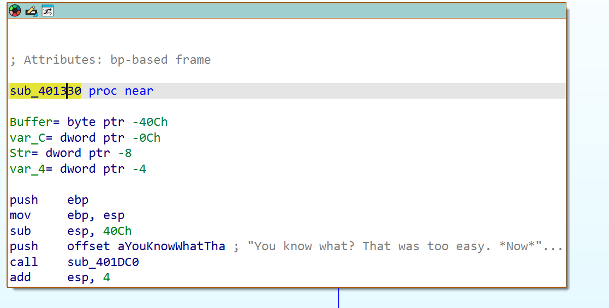
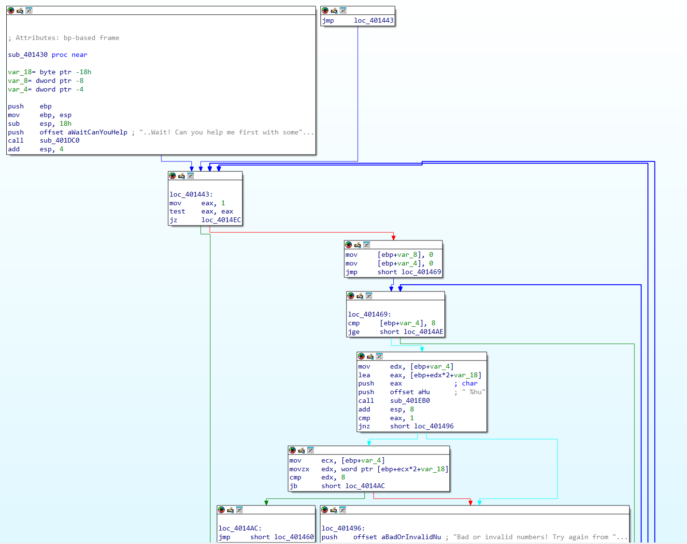
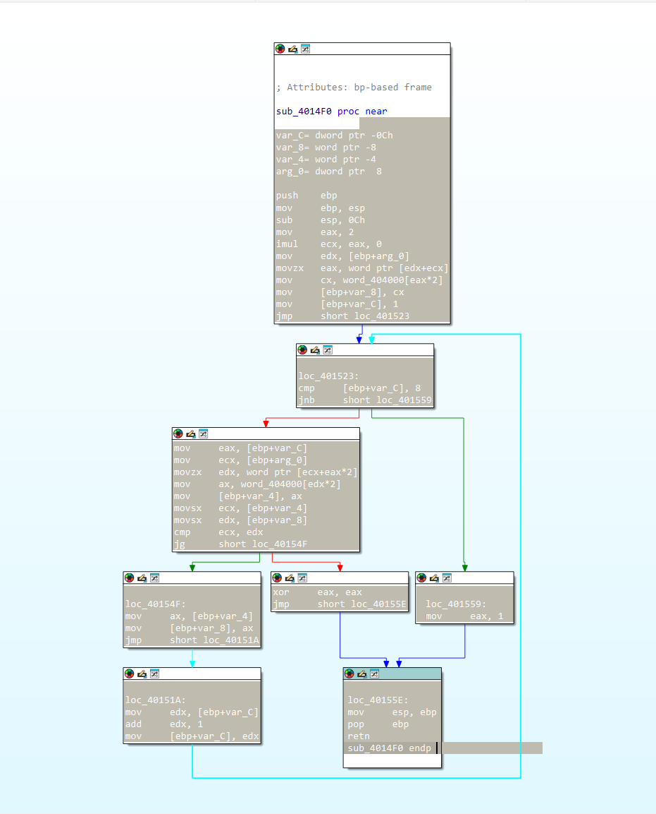
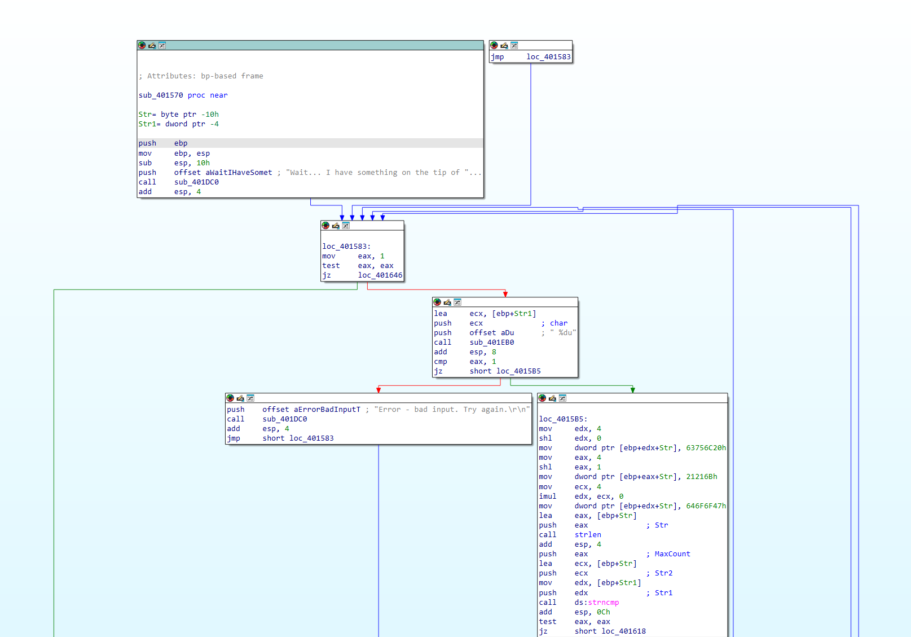
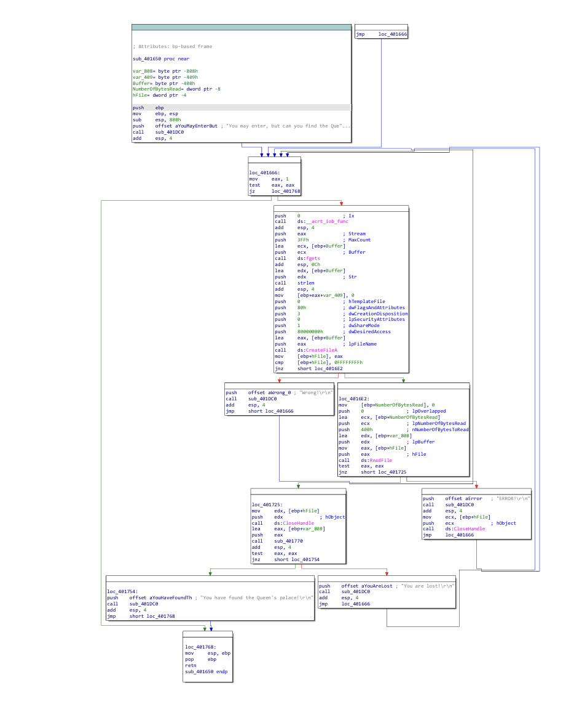
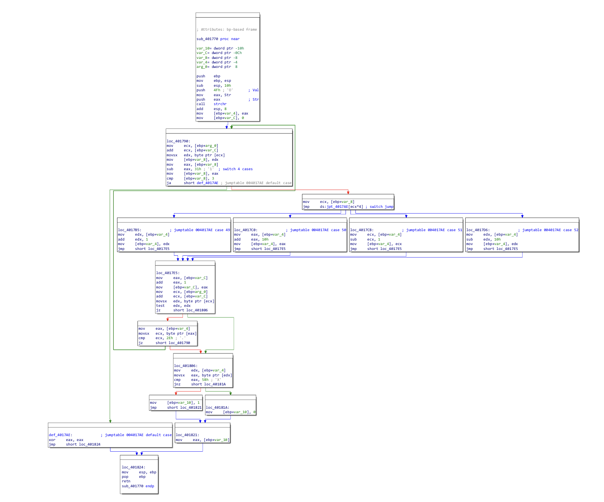

# Wonderland שלב 2


התחלתי מחלון ה-Strings ב-IDA, מצאתי את מחרוזת הפתיחה ("Welcome to Wonderland...") ועקבתי דרך ה - Xref שלה ל - main. ב - main יש switch case שמנתב לכל שלב לפי המספר שמכניסים, וראיתי שה- case של שלב 2 קורא לפונקציה `sub_401330`.

נכנסתי לפונקציה `sub_401330` כדי להבין מה היא עושה. ראיתי שהיא קוראת מחרוזת מהמשתמש עם `fgets`, ואז רצה עליה בלולאה שמתקדמת ב-4 בכל סיבוב, וכל 4 בתים עוברים פעולת XOR עם הקבוע `0x41524241`. בסוף הלולאה היא משווה את התוצאה למחרוזת הקבועה `"into the rabbit hole"` עם `strncmp`, ואם הן יוצאות שוות מקבלים "Correct! you may enter..".

<p align="center">
  <br>
  <sub>הפונקציה sub_401330: לולאת ה-XOR וה-strncmp</sub>
</p>

הבנתי שה-XOR נעשה על dword שלם בכל פעם, וכיוון שהמחשב עובד בשיטת Little Endian הבתים של `0x41524241` בזיכרון הם `41 42 52 41`. כלומר לכל בית במחרוזת עושים XOR לפי המיקום שלו במודולו 4, עם המפתח: `0x41, 0x42, 0x52, 0x41`.

מכאן הדרך לפתרון הייתה מהירה. XOR זו פעולה הפיכה, אז כל מה שהיה צריך זה לקחת את `"into the rabbit hole"` ולעשות לכל תו XOR עם הספרה המתאימה לו. כתבתי קוד פייתון קצר:

```python
s = "into the rabbit hole"
key = [0x41, 0x42, 0x52, 0x41]
password = ""
i = 0
while i < len(s):
    password += chr(ord(s[i]) ^ key[i % 4])
    i += 1
print(password)
```

והסיסמה שיצאה היא:

```
(,&.a6:$a03##+&a)->$
```


# Wonderland שלב 3

מה-switch case ידעתי שה-case של שלב 3 קורא לפונקציה `sub_401430`. נכנסתי וראיתי שהיא מבקשת מהמשתמש **8 מספרים** עם `scanf(" %hu", ...)`, מכניסה אותם למערך, ובודקת בלולאה שכל מספר שהוכנס נמצא בטווח **0-7**.

<p align="center">
  <br>
  <sub>הפונקציה sub_401430: קליטת 8 המספרים והבדיקה שכל אחד בטווח 0-7</sub>
</p>

אחרי שהמספרים תקינים, היא שולחת את כתובת המערך לפונקציה `sub_4014F0` וקוראת לה. הפונקציה הזו מחזירה 0 ב-EAX אם המערך לא עומד בתנאי, או 1 אם הוא כן.

נכנסתי ל-`sub_4014F0` וזה היה חלק מעניין. בכל סיבוב לוקחים מספר מהקלט של המשתמש, מכפילים ב-2 וניגשים איתו כאינדקס למערך אחר שנמצא בכתובת `0x404000`, וקוראים משם ערך של 2 בתים. אחר כך משווים: כל ערך שניגשים אליו חייב להיות **גדול ממש** מהערך הקודם. כלומר המשתמש צריך להזין 8 אינדקסים שימיינו את הערכים שבמערך מהקטן לגדול.

<p align="center">
  <br>
  <sub>הפונקציה sub_4014F0: הגישה למערך 0x404000 וההשוואה עם סימן</sub>
</p>

הלכתי לכתובת `0x404000` וקראתי את 8 הערכים שבמערך. בהתחלה הערכים נראו לי מוזרים, עד ששמתי לב לשני דברים: חלק מהמספרים שליליים, וההשוואה היא לפי מספרים **עם סימן** (`movsx` ואז `jg`). הערכים לפי האינדקס:

| index | 0 | 1 | 2 | 3 | 4 | 5 | 6 | 7 |
|---|---|---|---|---|---|---|---|---|
| value | 7 | 33 | 1 | -600 | -5000 | 1777 | 13 | 69 |

את הכיוון של המיון הבנתי לפי ההשוואה בתוך הלולאה: הפונקציה שומרת בכל פעם את הערך הקודם, קוראת ערך חדש לפי האינדקס שהמשתמש הכניס, ואז יש השוואה עם קפיצה מסוג `jg`, כלומר הערך החדש צריך להיות גדול מהערך הקודם. לכן הסדר שצריך להכניס הוא סדר עולה של הערכים, ובקלט מכניסים את האינדקסים של הערכים לפי הסדר הזה. מיינתי את הערכים מהקטן לגדול וכתבתי את האינדקס של כל אחד:

| הערך (מהקטן לגדול) | -5000 | -600 | 1 | 7 | 13 | 33 | 69 | 1777 |
|---|---|---|---|---|---|---|---|---|
| האינדקס שלו | 4 | 3 | 2 | 0 | 6 | 1 | 7 | 5 |

הקלט שצריך להכניס הוא רשימת האינדקסים בסדר הזה:

```
4 3 2 0 6 1 7 5
```


# Wonderland שלב 4

התרגיל הזה היה מבלבל בהתחלה ולקח לי זמן להבין מה לעשות.

מה-switch case הגעתי לפונקציה `sub_401570`. ראיתי שהשלב קולט **מספר** עם `scanf`, כשמחרוזת הפורמט שמופיעה ב-IDA היא בדיוק `" %du"` (ה-`%d` קורא את המספר, וה-`u` שאחריו הוא תו קבוע בפורמט). אחר כך התוכנית בונה בזיכרון מחרוזת קבועה ומשווה אותה לקלט שלי עם `strncmp`.

<p align="center">
  <br>
  <sub>הפונקציה sub_401570: ה-scanf, בניית "Good luck!!" וה-strncmp</sub>
</p>

המחרוזת הקבועה שהתכנית בונה מורכבת משלושה ערכים שמועתקים לזיכרון. תרגמתי אותם מ-Little Endian ל-ASCII:

```
0x646F6F47 = "Good"
0x63756C20 = " luc"
0x0021216B = "k!!"
```

כלומר המחרוזת היא `"Good luck!!"`. הבנתי שלא צריך להכניס את המחרוזת עצמה בגלל שהקלט נקלט בתור מספר, אבל בהמשך המספר הזה נשלח ל-`strncmp` כאילו הוא מצביע למחרוזת. כלומר התוכנית לא משווה את המספר עצמו, אלא הולכת לכתובת שהמספר מייצג וקוראת משם תווים. לכן הפתרון הוא לא להקליד `Good luck!!`, אלא להכניס מספר שהוא הכתובת שבה נמצאת המחרוזת הזו בזיכרון. ושמתי לב שהמחרוזת קיימת בתוך הודעת ההצלחה `"Yeah! Good luck!! (and good job!)"`. (יש בדיקה נוספת נגד רמאות, אסור להכניס את הכתובת של ה-buffer המקומי עצמו, אחרת מקבלים "Cheater..".)

חיפשתי ב-IDA איפה המחרוזת `"Good luck!!"` יושבת, פתחתי Hex view וראיתי שהיא מתחילה בכתובת `0x40473E`. תירגמתי את הכתובת לבסיס 10 במחשבון:

```
0x40473E = 4212542
```

וזה המספר שצריך להכניס:

```
4212542
```


# Wonderland שלב 5

מה-switch case הגעתי לפונקציה `sub_401650`, הפעם ראיתי שהקלט שלי הוא **שם של קובץ**: התכנית פותחת את הקובץ עם `CreateFileA`, קוראת את התוכן שלו עם `ReadFile`, ושולחת את התוכן לפונקציית בדיקה `sub_401770`.

<p align="center">
  <br>
  <sub>הפונקציה sub_401650: פתיחת הקובץ עם CreateFileA וקריאתו עם ReadFile</sub>
</p>

נכנסתי ל-`sub_401770`, הבנתי שזה מבוך לפי כמה סימנים, קודם ראיתי בזיכרון מחרוזת קבועה שנראית כמו מפה, עם הרבה `#`, נקודות `.`, האות `O` והאות `X`. אחר כך ראיתי שבפונקציה יש בדיקה של התווים שהמשתמש נותן, וכל תו משנה את המיקום הנוכחי: `1` מוסיף 1, `3` מחסיר 1, `2` מוסיף 16, ו-`4` מחסיר 16. בגלל שרוחב השורה במפה הוא 16, זה הסתדר כמו תנועה ימינה, שמאלה, למטה ולמעלה בתוך מפה. את ההתחלה `O` מאתרים עם `strchr`, כל צעד חייב לנחות על `.` (מעבר חוקי), `#` הוא קיר, והמטרה היא להגיע ל-`X`.

<p align="center">
  <br>
  <sub>הפונקציה sub_401770: ה-switch של 4 כיווני התנועה והבדיקה של '.' ו-'X'</sub>
</p>

הלכתי לכתובת של המפה בזיכרון (`0x404020`) וסידרתי את התווים בשורות של 16 כדי לראות את המבוך:

```
################
###O####...#####
###.##...#.#####
###.##.###.#####
###....###...X##
################
```

פתרתי את המסלול מ-`O` ל-`X` שעובר רק על תווי `'.'` (עם BFS בפייתון לפי המפה והחוקים שחילצתי מהקוד), והרצף שיצא:

```
2221114411411222111
```

הפתרון של השלב הוא בשני חלקים: קודם **יוצרים קובץ** שתוכנו הוא הרצף הזה, ואז כשהתכנית מבקשת קלט **מקלידים את הנתיב לקובץ**. אם המסלול נכון מקבלים "You have found the Queen's palace!".
